<!-- HERO BANNER -->

  

 

**Software Engineering · AI Orchestration · Cloud & Data Systems**

Arquitetando sistemas resilientes, pipelines de dados seguros e interfaces acessíveis com precisão técnica.

 

---

<h2 align="center">01 / About Me</h2>

Estudante de **Análise e Desenvolvimento de Sistemas** no Centro Universitário Senac (Campus Jurubatuba), focado na construção de **sistemas backend distribuídos, plataformas com IA em tempo real, engenharia de dados e acessibilidade digital**.

- Desenvolvimento de APIs e microsserviços com **Java (Spring Boot)** e **Python**.
- Construção de interfaces modernas e responsivas com **Next.js, TypeScript, Angular e Flutter**.
- Arquitetura de ingestão de dados com governança de PII, **SQLite, PostgreSQL, Azure e AWS**.
- Pesquisa científica (**PICTA 2026**) em acessibilidade digital (**WCAG 2.2 / eMAG 3.1**) para Smart Homes.

---

<h2 align="center">02 / Core Engineering Stack</h2>

**Backend & AI Systems**

**Frontend & Mobile**

**Cloud, Data & DevOps**

---

<h2 align="center">03 / Featured Systems & Products</h2>

| Projeto | Arquitetura & Impacto | Stack |
|:---|:---|:---|
| **[VoiceBridge AI](https://github.com/YagoFordEnter)** | Copiloto multilíngue em tempo real para reuniões e entrevistas técnicas (Brasil & Internacional) com transcrição Whisper e teleprompter inteligente | `Python` `Next.js` `Whisper` `Groq/LLM` |
| **[Captador & QG Analytics](https://github.com/YagoFordEnter)** | Pipeline modular de ingestão Meta/Webhooks com deduplicação determinística (`SHA-256`), minimização de PII e painéis públicos via Azure `$web` | `Python` `SQLite` `PostgreSQL` `Azure` |
| **[Sistema Milhão](https://github.com/YagoFordEnter)** | Plataforma SaaS full-stack com autenticação JWT, persistência relacional e painel operacional | `Java` `Spring Boot` `Angular` `PostgreSQL` |
| **[App CIC](https://github.com/YagoFordEnter)** | Aplicativo mobile de rastreabilidade de inventário no varejo com padrão GS1 / GTIN-13 e apoio à precificação | `Flutter` `Dart` `Supabase` |

---

<h2 align="center">04 / Research & Certifications</h2>

- **PICTA 2026 — Centro Universitário Senac:** Iniciação Científica avaliando acessibilidade em interfaces de Smart Homes com **Axe DevTools, Lighthouse, WAVE e NVDA** (`WCAG 2.2` / `eMAG 3.1`).
- **Certificações & Programas:** AWS Academy Cloud Foundations, Santander 2026 AI Java Back-end, Projeto Ford Enter (SENAI Ipiranga & Rede Cidadã), Oracle Academy Database Design & Foundations, Google AI Essentials.

---

<h2 align="center">05 / GitHub Analytics</h2>

  

